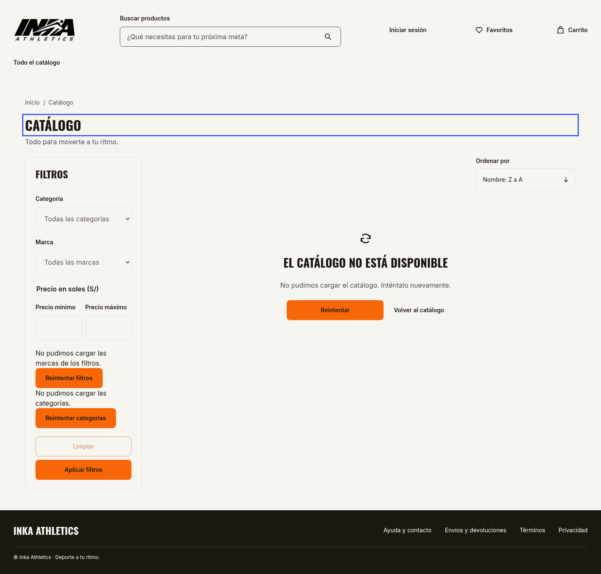
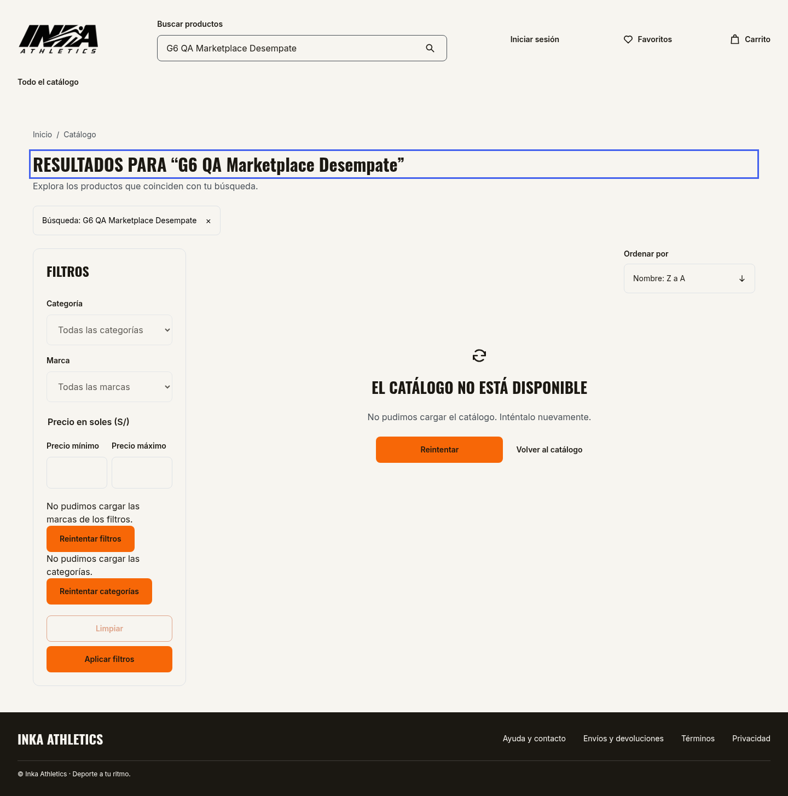

# TASK-F009-QA-001 — QA funcional del orden del catálogo

- **Corte:** 2026-11-27, 09:32–09:34 America/Lima (14:32–14:34 UTC)
- **Responsable:** GiulianoMaPe
- **Estado de issue:** abierta. No se solicita cierre.

## Entorno y alcance de esta revalidación

Probé la interfaz publicada en [g1-marketplace-frontend.vercel.app/catalogo](https://g1-marketplace-frontend.vercel.app/catalogo) con Playwright 1.64.1 y Google Chrome local, viewport 1440 × 1100. La navegación e interacciones fueron reales, sin interceptar ni sustituir respuestas. No inicié sesión ni hice escrituras. Se observaron únicamente solicitudes `GET` de lectura al catálogo.

La PR [FE #186](https://github.com/Taller-SW-Web/G1-Marketplace-Frontend/pull/186) está fusionada con `main` en `1f02acc128b0eb4dc200c6519811b41ee6b551c1`. Ese SHA identifica el merge de Git; **no confirma el SHA desplegado por Vercel**, que no estuvo expuesto en esta ejecución.

## Resultado de la UI publicada

El selector visible `Ordenar por` contiene `Orden del catálogo`, `NAME_ASC` y `NAME_DESC`. Al elegir ambos valores, la URL cambia y la página envía el criterio `sort` por `GET /api/catalog/products`.

La ejecución Playwright terminó con ocho solicitudes al catálogo; las ocho respondieron HTTP 503. La página mostró `EL CATÁLOGO NO ESTÁ DISPONIBLE`, sin tarjetas. Por eso no fue posible comparar los resultados del navegador ni abrir una página siguiente en este corte.

| Paso | URL/cambio observado | Respuesta del catálogo |
| --- | --- | --- |
| Catálogo inicial | `GET /api/catalog/products` | 503 |
| Selección `NAME_ASC` | `GET /api/catalog/products?sort=NAME_ASC` | 503 |
| Selección `NAME_DESC` | `GET /api/catalog/products?sort=NAME_DESC` | 503 |
| Búsqueda `G6 QA Marketplace Desempate`, `NAME_ASC`, `pageSize=2` | GET con esos criterios | 503 |
| Mismo empate, `NAME_DESC` | GET con `sort=NAME_DESC` | 503 |
| `q=running`, `sort=NAME_ASC`, `pageSize=2`, `page=1` | GET con `page=1` | 503 |
| Cambio a `NAME_DESC` desde `page=1` | URL pasa a `?q=running&sort=NAME_DESC&pageSize=2`; se retira `page` también del GET | 503 |
| `q=running`, `sort=NAME_ASC`, `pageSize=2`, `page=0` | GET con `page=0` | 503 |

El reinicio de página al cambiar `sort` sí quedó comprobado en la URL y en el GET, aunque la consulta no produjo tarjetas. Capturas de la página publicada:

## Trazas de disponibilidad y desempate REAL

Una lectura previa del BFF publicado en Render, a las **14:13:10 UTC**, para `NAME_ASC` y `pageSize=2`, respondió HTTP 200 con fuente `REAL`. La respuesta incluyó dos productos con el mismo nombre `G6 QA Marketplace Desempate` en orden de `productId ASC`. Su `X-Request-Id` fue `3048201d-2647-47a2-bacb-094223d2cbd3`:

| Etiqueta de prueba | `productId` | Nombre | Orden observado |
| --- | --- | --- | --- |
| `ord-002` | `8ad24563-c9da-4305-b650-1dd47a14fffb` | `G6 QA Marketplace Desempate` | 1.º |
| `ord-001` | `93f7f500-077d-432e-be98-31cb9ee0d66d` | `G6 QA Marketplace Desempate` | 2.º |

Esta lectura confirma el orden del empate en esa respuesta REAL del BFF. No reemplaza la observación del DOM de Vercel que quedó bloqueada por los 503 posteriores.

Una lectura independiente al proxy de Vercel con la misma búsqueda, `NAME_ASC`, `page=0` y `pageSize=2`, respondió **HTTP 503 `CATALOG_UNAVAILABLE`** el 2026-11-27 a las **14:33:16.750719 UTC**, request ID `36a4a706-27db-4f80-bf28-43409ddb43cc`. Una lectura al BFF Render a las **14:33:48 UTC** respondió **HTTP 503 `CATALOG_UNAVAILABLE`**, `X-Catalog-Source: REAL`, request ID `c48a79d5-d0b6-48de-9d65-7855604caaae`. Los eventos de Render para esos dos IDs muestran `diagnostic=PROVIDER_HTTP_403`. Esto identifica la respuesta 403 del proveedor configurado como señal registrada; **no determina por qué respondió 403** ni atribuye su causa a G6, WAF o grants.

Como contexto separado, una lectura anónima al endpoint APIM respondió 401, correlation ID `9f1a903b-120d-4c57-8573-2497896ba656`; esa respuesta requiere credenciales y no se usó como comprobación de aceptación. No hice llamadas directas a G6 durante esta revalidación.

La evidencia previa en [Backend #57, comentario del 26/11](https://github.com/Taller-SW-Web/G1-Marketplace-Backend/issues/57#issuecomment-7205471897) registra un retest REAL del empate desde Render y el orden `ord-002` → `ord-001` en Vercel móvil. El seguimiento del 27/11 en [Backend #57](https://github.com/Taller-SW-Web/G1-Marketplace-Backend/issues/57#issuecomment-7213592327) separa un intento de tamaño 2 sin respuesta HTTP de un retest anterior de tamaño 1 que reportó ambos sentidos y dos páginas. Esos cortes se mantienen fechados y no se mezclan con los 503 de hoy.

## Matriz por criterio

| Criterio | Resultado para este corte | Evidencia / límite |
| --- | --- | --- |
| Selector y enums permitidos | **PASS** | UI ofrece sólo valor por defecto, `NAME_ASC` y `NAME_DESC`; se usaron ambos controles reales. El contrato también restringe `allowedSorts` a esos dos valores. |
| URL y solicitud GET reflejan el orden | **PASS** | Observados los cambios de URL y GET con `sort=NAME_ASC` y `sort=NAME_DESC`; las respuestas fueron 503. |
| Cambio de orden reinicia `page` | **PASS** | Desde `page=1`, cambiar a `NAME_DESC` quitó `page` de la URL y del GET observado. |
| Enum inválido no llega al proveedor | **Evidencia previa; no revalidado en este corte** | No se reenvió un enum inválido al sitio público. El selector no lo ofrece; `criteriaError` rechaza valores fuera de `allowedSorts`. Véanse enlaces de código y pruebas abajo. |
| Orden visible global NAME_ASC / NAME_DESC | **INCONCLUSIVE en la UI de este corte** | Ocho GET de productos recibieron 503; no hubo tarjetas que comparar. |
| Desempate REAL `productId ASC` | **PASS en una lectura previa REAL del BFF; UI de este corte inconclusa** | Dos homónimos ordenados `ord-002` → `ord-001` (IDs indicados arriba); la UI Vercel posterior respondió 503. La evidencia histórica separada está enlazada a #57. |
| Continuidad y no ordenar sólo las tarjetas de la página actual | **INCONCLUSIVE para la revalidación actual** | Esta UI no ofreció página siguiente con el catálogo en error. #57 conserva retest REAL anterior de tamaño 1 y dos páginas; no certifica el corte actual con `pageSize=2`. |

Para el contrato de invalidación y la lista de opciones, véanse [CatalogSortSelect.tsx en el merge de #186](https://github.com/Taller-SW-Web/G1-Marketplace-Frontend/blob/1f02acc128b0eb4dc200c6519811b41ee6b551c1/src/features/catalog/CatalogSortSelect.tsx#L5-L10), [criteria.ts](https://github.com/Taller-SW-Web/G1-Marketplace-Frontend/blob/1f02acc128b0eb4dc200c6519811b41ee6b551c1/src/features/catalog/criteria.ts#L3-L38), [prueba de opciones del selector](https://github.com/Taller-SW-Web/G1-Marketplace-Frontend/blob/1f02acc128b0eb4dc200c6519811b41ee6b551c1/tests/components/catalog-controls-h4.test.tsx#L87-L93) y [prueba de criterios inválidos](https://github.com/Taller-SW-Web/G1-Marketplace-Frontend/blob/1f02acc128b0eb4dc200c6519811b41ee6b551c1/tests/catalog/criteria-h4.test.ts#L19-L25). No ejecuté esas pruebas locales en este corte; las referencias identifican el contrato y la evidencia automatizada ya existente, no una nueva ejecución.

## Dependencias y cierre

Al revisar antes de la prueba, FE #33 seguía abierta y pendiente de aceptación independiente; BE #56 estaba cerrada; INT #57 seguía abierta. #34 permanece abierta. Esta nota no modifica tareas de otras personas, no marca gates de aceptación ni pide cerrar #34. Para aceptar el comportamiento end-to-end de este corte aún hace falta una ejecución pública con respuesta de catálogo, comparación real de páginas y revisión independiente.
