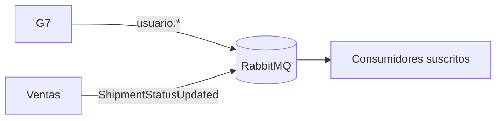

# #321 — Contrato de eventos

Registrar aquí los contratos publicados por G7 (`usuario.*`) y Ventas (`ShipmentStatusUpdated`), junto con ejemplos versionados y runs de productor/consumidor. No completar campos del payload por suposición: enlazar la definición fuente aprobada.

| Productor | Evento | Versión / schema | Contrato fuente | Run productor | Run consumidor | Resultado |
|---|---|---|---|---|---|---|
| G7 | `usuario.*` (enumerar nombres concretos) | Pendiente | Pendiente | Pendiente | Pendiente | Pendiente |
| Ventas | `ShipmentStatusUpdated` | Pendiente | Pendiente | Pendiente | Pendiente | Pendiente |

## Diagrama de publicación y consumo

## Campos de contrato a enlazar

Para cada evento, adjuntar el schema fuente y documentar: nombre y versión, clave de enrutamiento, payload, identificador de evento, `correlation-id`, política de reintento/duplicados y compatibilidad. Los valores y políticas deben salir del contrato aprobado.

| Evento | Tabla de campos / schema | Ejemplos válidos | Compatibilidad / versionado | Responsable |
|---|---|---|---|---|
| `usuario.*` | Pendiente | Pendiente | Pendiente | Pendiente |
| `ShipmentStatusUpdated` | Pendiente | Pendiente | Pendiente | Pendiente |

