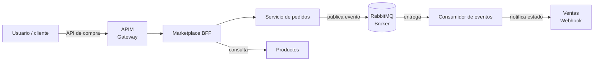

# #325 — Arquitectura C4 de la compra

Diagrama base del flujo que se presentará. APIM (gateway), RabbitMQ (broker) y el webhook de Ventas se consideran componentes existentes y operativos, según el estado informado para esta exposición. Adjuntar después las URLs de despliegue, configuración no sensible y runs que acrediten la ejecución.

> Revisar nombres de servicios y flechas con los líderes antes de congelar. Este diagrama resume el recorrido; no sustituye la vista C4 de contexto/contenedores ni la configuración desplegada.

## Enlaces de evidencia

| Componente / salto | Run | Reporte | Tabla / configuración no sensible | Responsable |
|---|---|---|---|---|
| APIM → BFF | Pendiente | Pendiente | Pendiente | Pendiente |
| BFF → Productos / pedidos | Pendiente | Pendiente | Pendiente | Pendiente |
| Pedidos → RabbitMQ | Pendiente | Pendiente | Pendiente | Pendiente |
| RabbitMQ → consumidor | Pendiente | Pendiente | Pendiente | Pendiente |
| Consumidor → webhook de Ventas | Pendiente | Pendiente | Pendiente | Pendiente |

## Datos para la vista C4

| Nivel | Artefacto | Enlace |
|---|---|---|
| Contexto | Actores y sistemas externos | Pendiente |
| Contenedores | APIM, BFF, servicios, RabbitMQ, consumidor y Ventas | Pendiente |
| Componentes | Configuración interna relevante para el flujo | Pendiente |

